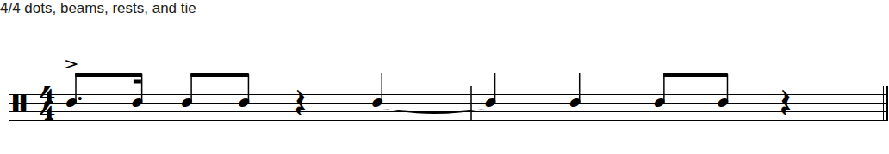
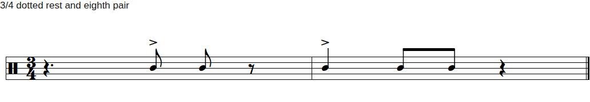
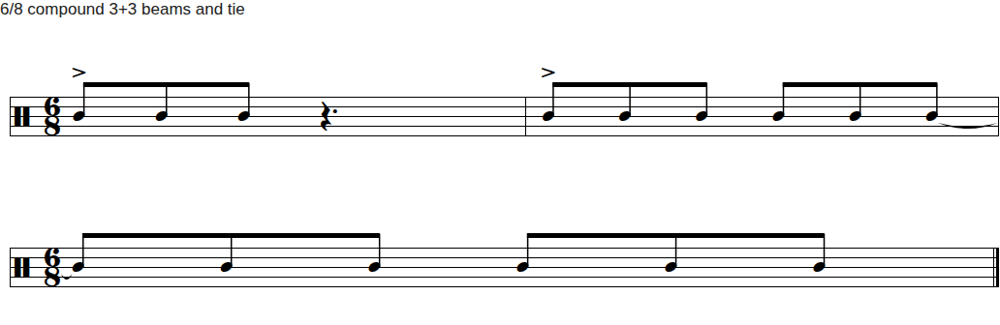
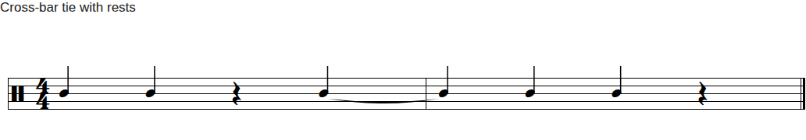

# Rhythm Training — Báo cáo triển khai Phase 2

## 1. Kết luận và phạm vi

Đã triển khai **Rhythm Generator và Notation Projection**, không triển khai Phase3. Kết quả source cuối: **436/436 test passing trong40 file**, bao gồm toàn bộ **328 test nền** và **108 test mới**. `pnpm check`, `pnpm test`, `pnpm build:static` và `pnpm build` đều thành công sau sửa lỗi cuối cùng. Đã chạy riêng320 seed generator,320 bộ lựa chọn,1.920 phép so sánh cặp distractor và84 ca renderer/parity/ink-bounds trong Chromium thật.

Tất cả source, test và tài liệu/bằng chứng mới trong repository nằm dưới `client/src/modules/rhythm-training/`. Canonical production/theory-test files của Phase1 giữ nguyên byte. Note Reading, app shell/catalog, manifest route, shared scoring/session, database, package/lockfile, WordPress và infrastructure không bị thay đổi. Rhythm Training vẫn **Coming Soon**. Không thêm dependency, không triển khai UI bài tập, playback, metronome, tap matching hay MIDI. Không deploy.

## 2. Các interface Phase1 thực sự tái sử dụng

| Interface | Vai trò trong Phase2 |
|---|---|
| `RhythmPattern`, `RhythmSegment`, `RhythmMeter`, `WrittenDuration` | Dữ liệu canonical readonly; descriptor và thứ tự segment vẫn là authority |
| `durationToTicks` và PPQ480 | Arithmetic số nguyên cho vocabulary và exact-fill |
| `deriveMeter` | Capacity ô nhịp, pulse quarter/simple và dotted-quarter/6/8 |
| `requireValidRhythmPattern` / `validateRhythmPattern` | Chặn measure sai, tie sai, cache sai và descriptor không được hỗ trợ |
| `deriveRhythmTimeline` | Tick start/end, onset, tie roles và coalesced sounding spans |
| `notationSignature`, `onsetSignature`, `soundingSignature` | Nền tảng identity/equivalence của đáp án |

Không sao chép hoặc sửa lại các công thức Phase1. VexFlow voice fractions/TickContext positions là kiểm chứng thứ cấp, không thay thế validator canonical.

## 3. Generator và curriculum

API `generateRhythmPattern` nhận seed, level1–8, meter/bars/pulseBpm/focus tùy chọn và trả pattern canonical immutable. PRNG chỉ phụ thuộc seed; không dùng nguồn random theo clock. Exact-fill construction hoàn thành từng measure theo capacity số nguyên, sau đó canonical validation và level audit đều phải passing. Seed giống nhau cùng cấu hình cho cùng toàn bộ pattern, không chỉ cùng tổng duration.

| Level | Vocabulary/constraint chính đã triển khai |
|---|---|
| 1 | Simple meter, giá trị cơ bản quarter/half/whole phù hợp capacity |
| 2 | Rests trong vocabulary đã học; không phát sinh tie/dot/fine-grid ngoài focus |
| 3 | Subdivision eighth trong simple meter; cặp subdivision thông thường không bị đếm nhầm là một nguồn syncopation mới |
| 4 | Introductory dots và ties theo focus; giữ grid/vocabulary quen thuộc và kiểm soát cross-bar tie |
| 5 | Sixteenth và dotted eighth trong fine-grid focus; hạn chế vị trí introducing fine grid; không cho cross-bar tie |
| 6 | Chỉ6/8, hai pulse720 ticks; compound grouping, rests/dots phù hợp, không coi6/8 là sáu quarter beats |
| 7 | Simple-meter offbeat sustain/syncopation được kiểm soát; có thể dùng tie đã học; giới hạn ngân sách mỗi bar |
| 8 | Vocabulary tổng hợp với tối đa hai nguồn dot/tie/fine/syncopation tương tác; compound pulse-defining dot không bị đếm như một khái niệm dot mới |

Meter/focus được hỗ trợ, rest limits, tempo bands và tie permissions là policy data rõ ràng trong `generation/levels.ts`. Cấu hình unsupported bị từ chối, không âm thầm đưa vocabulary khó hơn. `assertLevelConstraints` cũng kiểm tra pattern bên ngoài generator. Generator không phát sinh pattern zero-attack để tránh câu hỏi silent-answer mơ hồ; renderer vẫn nhận all-rest canonical hợp lệ.

## 4. Answer signatures và distractors

`answerSignatures` tạo identity từ canonical notation, visible structure, intended sounding spans và onsets. `generateRhythmChoices`/`selectRhythmChoices` tạo target, stable correct-option ID, seeded option order và rejection evidence; đây là **data API**, không phải UI hay exercise mode.

Mọi option phải cùng meter, pulse BPM và số ô nhịp. Reject shape canonical sai, equivalent notation, visible-equivalent hay intended-sounding-equivalent; onset discrimination còn yêu cầu onset signatures khác. Những khác biệt chỉ ở ID, tempo, accent, cách chia rest hoặc tie-versus-sustain không được dùng làm distractor tương đương/mơ hồ. Tie continuation không tạo attack thứ hai.

Candidate search hữu hạn256 attempts. Thiếu shape distinct thì throw `InsufficientDistinctChoicesError` có requested/available/attempt counts, không chèn đáp án trùng. Ví dụ one-bar2/4 dots-only introductory context chỉ cung cấp ba sounding shapes được chấp nhận: yêu cầu bốn option **phải fail rõ ràng**; yêu cầu ba thành công. Khi meter chưa được chỉ định, four-option dots/combined context chọn4/4 để có diversity; meter chỉ định rõ không bị thay đổi.

Bằng chứng thực thi độc lập: mỗi level chạy40 repeated seeds và40 repeated choice sets, tổng320 patterns/320 sets. Cả1.920 cặp option đã qua pairwise uniqueness guards. Đây là kiểm chứng toán học intended sound, **không phải thử nghiệm nghe trên thiết bị**.

## 5. Rhythm-owned notation adapter

`projectRhythmNotation` dùng một timeline canonical đã validate để map notes/rests, durations/dots, pulse-contained beam groups và adjacent tie links. `renderRhythmNotation` dùng VexFlow5 đã có sẵn để tạo SVG thật, gồm Stave/Voice/StaveNote/Dot/Beam/StaveTie. Notes có placement trung tính cố định B4 và percussion clef; không import pitch theory của Note Reading.

Các invariant đã test:

- Six eighths trong6/8 beam **3+3**, boundaries720/1440 ticks; cùng sáu eighths trong3/4 beam **2+2+2**.
- Dotted eighth360 + sixteenth120 cùng pulse được beam; rest, pulse boundary và barline ngắt beam.
- Beam gắn trước note drawing để không vẽ thêm flags lên beamed notes.
- Ties trong một row dùng full arc; ties qua row break dùng hai partial arcs, không nối chéo hai dòng.
- Internal barlines là single; cuối pattern là final barline. Rests giữ đúng duration canonical, không coerce whole rest thành duration khác ở6/8.
- Voice totals và actual TickContext start/duration fractions khớp canonical positions. Với resolution VexFlow16384/whole, canonical sixteenth120 tương ứng1024 VexFlow ticks; regression dùng tích chéo fraction, không dựa vào floating-point approximation.
- Layout natural-width, vùng trống cuối ô cho flag/dot và uniform SVG viewBox scaling tránh clipping/distortion. Width dưới1px bị từ chối. Narrow multi-bar requested layout có thể nhỏ; UX learner-facing readability là việc của phase UI sau này.

## 6. Actual rendered examples

Các PNG/SVG dưới đây được tạo bằng adapter thật trong Chromium, không phải mockup hay hình vẽ minh họa thay thế. Temporary browser verification document không được đăng ký thành app page/route.

### 4/4 — dots, rests, beams và cross-bar tie

Bar1: `360 +120 +240 +240 +480(rest) +480 =1920`; bar2: `480 +480 +240 +240 +480(rest) =1920`. Dotted-eighth/sixteenth beam covers `[0,480)`. Cross-bar tie merges `[1440,2400)`; continuation tại1920 không attack. Strict notation parity passing.

### 3/4 — dotted rest và eighth pair

Bar1: `720(dotted rest) +240 +240 +240(rest) =1440`; bar2: `480 +240 +240 +480(rest) =1440`. Beam của cặp eighth ở bar2 covers absolute `[1920,2400)`. Dotted rest chiếm trọn720 ticks và không attack. Strict notation parity passing.

### 6/8 — compound3+3, dotted rest, beams và row-break tie

Bar1: `240 +240 +240 +720(dotted rest) =1440`; bars2/3 mỗi bar gồm sáu eighths, tổng1440. Beam groups ở bars2/3 đều chia ba nốt trên mỗi pulse720. Tie từ eighth cuối bar2 sang eighth đầu bar3 merges `[2640,3120)`, không attack tại2880; khi xuống row, hai partial arcs giữ nguyên identity/timing. Strict notation parity passing.

### Additional 4/4 cross-bar fixture

Hai bar đều `4 ×480 =1920`; tie `[1440,2400)` chỉ có một attack. Fixture được render ở cả one-row và row-break layouts trong test/browser evidence.

SVG tương ứng, ảnh tổng hợp và exact projection/parity records nằm trong `evidence/phase2/`.

## 7. Lỗi phát hiện và sửa trong triển khai

| Lỗi/root cause | Sửa và evidence |
|---|---|
| Curriculum audit phụ thuộc subset vocabulary ngẫu nhiên hoặc đếm paired subdivisions như new syncopation | Audit dựa trên level/focus ổn định; coalesced sustain crossing-pulse rule; broad-seed/curriculum matrix và regressions passing |
| Fine-grid tied neighbors không thể split theo cách cũ; integrated tie augmentation có thể vượt difficulty budget | Reuse adjacent valid ties, guard augmentation và tái validate ngân sách; reproducible fine/tie fixture passing |
| Four-option dots-only nhỏ không đủ distinct shapes | Fail closed có counts; diversity-safe default context không override explicit meter; tests cho ba/bốn option passing |
| Beam bằng default/simple grouping, dotted pair bị bỏ qua, note có thể giữ flag | Pulse-owned beam projection; construct beam trước draw;3+3/2+2+2 và glyph regressions passing |
| Cross-row tie dùng full arc; sizing dùng spacing width thay cho glyph extent; cuối ô thiếu flag/dot gap | Partial arcs theo row, glyph bounding-box guard, right-space reserve và uniform scaling; narrow/dense/generated notation parity passing |
| External level validator bỏ qua `allowCrossBarTies:false` ở Level5 | Rà soát độc lập phát hiện; `tiePolicy.test.ts` **failed trước sửa**, sau guard thì Level5 reject còn Level4/8 accept; toàn bộ bốn check đã rerun thành công |

Hai lỗi harness cũng được sửa mà không che lỗi production: VexFlow fraction string `n/d` phải so sánh bằng tích chéo, không `Number("n/d")`; SVG text getBBox chứa font em-box không phải ink bounds, nên browser verification dùng actual canvas glyph metrics cộng path bounds. Không dùng em-box lớn để kết luận clipping giả.

## 8. Kết quả kiểm tra cuối

| Lệnh/evidence | Kết quả |
|---|---|
| Baseline trước thay đổi |328 tests /29 files passing |
| `pnpm check` |PASS, `tsc --noEmit`, exit0 |
| `pnpm test` |**436 tests /40 files passing,0 failed** |
| Giữ test nền |Mọi baseline test file vẫn có cùng test count và passing;328/328 |
| Tests mới |108:59 generation/choices/curriculum và49 notation |
| `pnpm build:static` |PASS, exit0 |
| `pnpm build` |PASS, frontend và backend esbuild, exit0 |
| Generator/distractor repeatability probe |320 seeds +320 choice sets +1.920 pair checks passing |
| Chromium actual renderer matrix |84 cases passing ở320/768/1040px; actual fraction parity, beam count, tie arc height và ink bounds checked |
| Phase1 valid/invalid renderer fixtures |Tất cả11 valid fixtures render/parity;10 invalid fixtures reject trước khi thay container |
| Preservation |All changes nằm trong Rhythm module; canonical Phase1/Note Reading/catalog/route/dependencies/shared/infrastructure byte-identical |

Build có cảnh báo inherited về `api/platform/config.js` non-module script và Note Reading/VexFlow chunk lớn hơn500KB. Chúng không khiến build fail; không sửa protected build/dependency configuration ngoài phạm vi. Dòng log auth về missing fields thuộc negative server test hiện có, không phải failure của test suite.

Full logs và preservation evidence nằm tại `evidence/phase2/`. Manifest vẫn chỉ có `/` và `/note-reading`; frontend không có active Rhythm route. Không thực hiện publish/deploy hoặc thao tác WordPress.

## 9. Files created/modified

Danh sách đầy đủ từng file, phân biệt CREATED/MODIFIED, nằm trong [changed-files manifest](evidence/phase2/changed-files.txt). Tóm tắt nhóm thực tế:

- `generation/`: PRNG, policies, exact generator, answer signatures, choices và toàn bộ unit/matrix/regression tests.
- `notation/`: pure projection, VexFlow adapter, actual example fixtures và projection/render/regression tests.
- `index.ts`: chỉ bổ sung Phase2 API exports; giữ exports Phase1.
- `tests/scope.test.ts`: chỉ mở allowlist cho VexFlow đã có; giữ Coming Soon/route/no-audio/Note Reading boundary assertions.
- `README.md`, `plan.md`, `TODO.md`: module-local documentation của Phase2.
- `Phase-2-Implementation-Report.md` và `evidence/phase2/`: báo cáo, logs, JSON proof, SVG/PNG thực tế; không phải frontend assets/routes.

## 10. GitHub synchronization

**Đã commit và push thành công:** source commit `196ae2564611dd31a56dc76950f362d6d860d824` trên private repository `thaikeyboard178-art/thaikeyboard-music-platform`, branch `main`. Git push trả về `main -> main`; ngay sau push, local HEAD và tracking `origin/main` cùng đúng SHA này, worktree sạch. Commit gồm46 file trong phạm vi module:41 created và5 modified; full manifest đã lưu. Auto-publish được kiểm tra là `false` trước push. Không force-push, không đổi branch/repo/history, không deploy.

Sau source handoff, báo cáo/TODO được cập nhật bằng kết quả xác nhận trong một documentation-only commit. Nó không sửa source đã test. Bản bàn giao cuối ghi latest documentation tip sau khi push tài liệu thành công; không dùng source SHA để tự nhận một platform publication hoặc deployment.

## 11. Remaining limitations và điểm dừng

Audible indistinguishability hiện chỉ kiểm chứng intended mathematical spans/onsets. Chưa có audio scheduler, browser/device hearing test, metronome, tap capture/matching, exercise modes, exercise UI hoặc learner usability test. Không được hiểu một shape sounding signature distinct là đã chứng minh người dùng trên mọi thiết bị chắc chắn phân biệt nghe được. Một số vocabulary/context quá nhỏ fail explicitly thay vì hạ chất lượng distractors. Cross-browser/device typography và comfortable sizing sẽ cần kiểm tra khi frontend activation được duyệt.

**STOP tại Phase2. Phase3 chưa bắt đầu và cần phê duyệt rõ ràng mới.**
