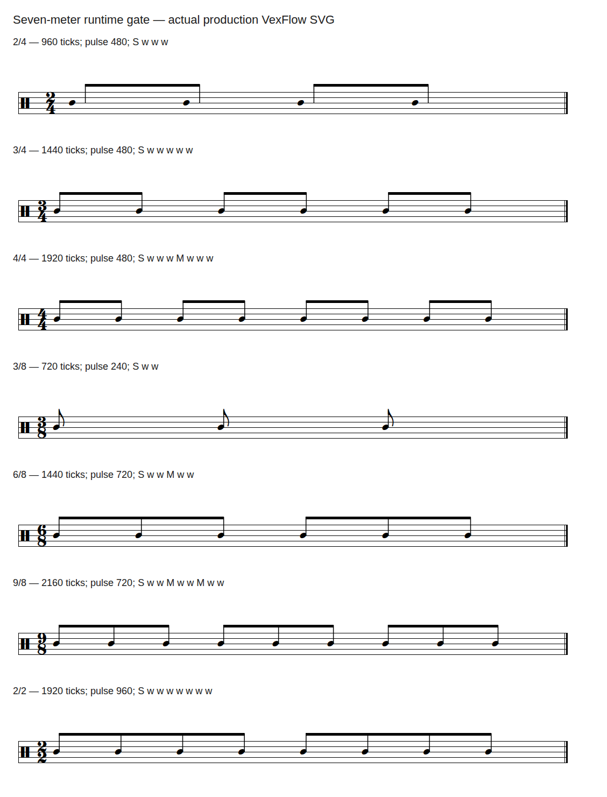

# Seven-Meter Runtime Implementation and Release-Gate Report

Date: 11 November 2026. Baseline source: `35b82324e30453a0b175c8f6c5003a1d1aa47786`.

## Conclusion and exact scope

**Seven-meter Phase 1 runtime release gate: COMPLETE.** All seven requested meters executed all ten required stages: **70/70 PASS** in the production-executing automated tests and again in real Chromium. This conclusion is based on full canonical patterns, exact duration/pulse calculations, full/under/over validation, real timelines, independent structural metadata, notation projection, VexFlow strict Voice/Fraction/TickContext parity and actual drawn SVG beams/flags—not unions, fixtures, configuration names or time-signature labels alone.

This gate does **not** mean the complete learner-facing Rhythm V1 product is finished. Rhythm remains Coming Soon. The existing eight generator level policies still allow the original four-meter curriculum; curriculum migration, exercise UI/modes, audio scheduler/playback/counting/metronome/tap capture, MIDI and microphone remain **NOT IMPLEMENTED** by this task. No catalog/static route activation, Note Reading/shared-contract/infrastructure/database/WordPress/dependency change or deployment was made.

## Executed checks

| Check | Final result | Evidence |
|---|---|---|
| Fresh baseline `pnpm test` | 436/436 PASS, 40 test files | `evidence/seven-meter/tests-before.txt` |
| Final `pnpm check` | PASS, `tsc --noEmit`, no errors | `evidence/seven-meter/typecheck.txt` |
| Final `pnpm test` | 565/565 PASS, 44 test files; 0 failed | `evidence/seven-meter/tests.txt` |
| Machine-readable full rerun | 565 PASS, 0 failed | `evidence/seven-meter/tests.json` |
| Added coverage | 129 new cases; 106 cases in runtime suites including all70 named mandatory stages | Exact assertion results in JSON |
| `pnpm build:static` | PASS | `evidence/seven-meter/build-static.txt` |
| `pnpm build` | PASS, frontend + bundled backend | `evidence/seven-meter/build-full.txt` |
| Real Chromium production pipeline | All70 stage checks PASS; 35 actual SVG render cases | `evidence/seven-meter/browser-runtime-evidence.json` |
| Legacy generator compatibility | 32/32 sampled seeded canonical patterns identical before/after the one-line helper correction | `evidence/seven-meter/generator-compatibility.json` |
| Protected source hashes | 196 tracked files outside Rhythm byte-identical | `evidence/seven-meter/preservation.json` |

The existing oversized Note Reading/VexFlow chunk warning remains non-blocking; no dependency/build configuration was changed to hide it. The authentication negative test intentionally prints a missing-fields warning; all assertions passed. Build success is not deployment success, and no deploy was attempted.

## Runtime reference coordinates

PPQ=480. Bar-local positions are integer ticks. The main proof fixtures contain complete eighth-note patterns so each note onset also exercises a 240-tick subdivision cell. `subdivisionTicks=240` in the table; the default120 grid is independently tested and used by notation for dotted-eighth/sixteenth boundaries. Structural grid accents are derived separately from explicit note accents.

| Meter | Bar capacity | Pulse ticks | Main pulse positions | Subdivision positions (240 ticks) | Structural accent positions | Actual onset positions |
|---|---:|---:|---|---|---|---|
| 2/4 | 960 | 480 | `[0, 480]` | `[0, 240, 480, 720]` | `0:strong, 240:weak, 480:weak, 720:weak` | `[0, 240, 480, 720]` |
| 3/4 | 1440 | 480 | `[0, 480, 960]` | `[0, 240, 480, 720, 960, 1200]` | `0:strong, 240:weak, 480:weak, 720:weak, 960:weak, 1200:weak` | `[0, 240, 480, 720, 960, 1200]` |
| 4/4 | 1920 | 480 | `[0, 480, 960, 1440]` | `[0, 240, 480, 720, 960, 1200, 1440, 1680]` | `0:strong, 240:weak, 480:weak, 720:weak, 960:medium, 1200:weak, 1440:weak, 1680:weak` | `[0, 240, 480, 720, 960, 1200, 1440, 1680]` |
| 3/8 | 720 | 240 | `[0, 240, 480]` | `[0, 240, 480]` | `0:strong, 240:weak, 480:weak` | `[0, 240, 480]` |
| 6/8 | 1440 | 720 | `[0, 720]` | `[0, 240, 480, 720, 960, 1200]` | `0:strong, 240:weak, 480:weak, 720:medium, 960:weak, 1200:weak` | `[0, 240, 480, 720, 960, 1200]` |
| 9/8 | 2160 | 720 | `[0, 720, 1440]` | `[0, 240, 480, 720, 960, 1200, 1440, 1680, 1920]` | `0:strong, 240:weak, 480:weak, 720:medium, 960:weak, 1200:weak, 1440:medium, 1680:weak, 1920:weak` | `[0, 240, 480, 720, 960, 1200, 1440, 1680, 1920]` |
| 2/2 | 1920 | 960 | `[0, 960]` | `[0, 240, 480, 720, 960, 1200, 1440, 1680]` | `0:strong, 240:weak, 480:weak, 720:weak, 960:weak, 1200:weak, 1440:weak, 1680:weak` | `[0, 240, 480, 720, 960, 1200, 1440, 1680]` |

For3/8, the three240-tick pulses are simple eighth beats, not one compound pulse. For6/8 and9/8, the720-tick pulses each contain three eighth subdivisions; only the first pulse is strong and subsequent compound pulses are medium. In2/2, half-note pulses are960 ticks; it does not borrow4/4's480-tick quarter pulse despite equal bar capacity.

`segment.accent` remains the canonical enum `normal|strong`, unchanged. Structural `strong|medium|weak` is a separate immutable derived layer, carried into projection and SVG `data-structural-accent` attributes. Tests explicitly accent a weak-position note and verify structural hierarchy/positions do not change. Rests remain silent, and tied continuations remain without onset even when a bar's structural strong position falls at the continuation.

## Mandatory final verification table

Every cell below includes the **exact executed test name** from Vitest JSON and the actual production function(s) called. No stage is skipped or substituted. All PASS cells are **IMPLEMENTED AND EXECUTED SUCCESSFULLY**. The machine-readable counterpart is `evidence/seven-meter/release-matrix.json`.

| Meter | Canonical acceptance | Duration / pulse | Valid full bar | Under + over reject | Timeline onsets | Pulse / subdivisions | Structural accents | Notation projection | Actual SVG | SVG beam / flags |
|---|---|---|---|---|---|---|---|---|---|---|
| 2/4 | **PASS** — `Seven-meter runtime completion gate 7M 2/4 S01 canonical model acceptance` → `rhythmPatternInputSchema.safeParse; requireValidRhythmPattern` | **PASS** — `Seven-meter runtime completion gate 7M 2/4 S02 exact duration and pulse calculations` → `durationToTicks; deriveMeter; ticksToSeconds` | **PASS** — `Seven-meter runtime completion gate 7M 2/4 S03 correctly filled bar validation` → `validateRhythmPattern` | **PASS** — `Seven-meter runtime completion gate 7M 2/4 S04 underfilled and overfilled rejection` → `validateRhythmPattern; deriveRhythmTimeline; projectRhythmNotation; renderRhythmNotation` | **PASS** — `Seven-meter runtime completion gate 7M 2/4 S05 timeline onset derivation` → `deriveRhythmTimeline` | **PASS** — `Seven-meter runtime completion gate 7M 2/4 S06 structural pulse and subdivision metadata` → `deriveMeterStructure; deriveRhythmTimeline` | **PASS** — `Seven-meter runtime completion gate 7M 2/4 S07 independent structural accents` → `deriveRhythmTimeline; projectRhythmNotation` | **PASS** — `Seven-meter runtime completion gate 7M 2/4 S08 notation grouping and beam projection` → `projectRhythmNotation` | **PASS** — `Seven-meter runtime completion gate 7M 2/4 S09 actual VexFlow SVG rendering` → `renderRhythmNotation` | **PASS** — `Seven-meter runtime completion gate 7M 2/4 S10 rendered approved beam and flag rules` → `renderRhythmNotation` |
| 3/4 | **PASS** — `Seven-meter runtime completion gate 7M 3/4 S01 canonical model acceptance` → `rhythmPatternInputSchema.safeParse; requireValidRhythmPattern` | **PASS** — `Seven-meter runtime completion gate 7M 3/4 S02 exact duration and pulse calculations` → `durationToTicks; deriveMeter; ticksToSeconds` | **PASS** — `Seven-meter runtime completion gate 7M 3/4 S03 correctly filled bar validation` → `validateRhythmPattern` | **PASS** — `Seven-meter runtime completion gate 7M 3/4 S04 underfilled and overfilled rejection` → `validateRhythmPattern; deriveRhythmTimeline; projectRhythmNotation; renderRhythmNotation` | **PASS** — `Seven-meter runtime completion gate 7M 3/4 S05 timeline onset derivation` → `deriveRhythmTimeline` | **PASS** — `Seven-meter runtime completion gate 7M 3/4 S06 structural pulse and subdivision metadata` → `deriveMeterStructure; deriveRhythmTimeline` | **PASS** — `Seven-meter runtime completion gate 7M 3/4 S07 independent structural accents` → `deriveRhythmTimeline; projectRhythmNotation` | **PASS** — `Seven-meter runtime completion gate 7M 3/4 S08 notation grouping and beam projection` → `projectRhythmNotation` | **PASS** — `Seven-meter runtime completion gate 7M 3/4 S09 actual VexFlow SVG rendering` → `renderRhythmNotation` | **PASS** — `Seven-meter runtime completion gate 7M 3/4 S10 rendered approved beam and flag rules` → `renderRhythmNotation` |
| 4/4 | **PASS** — `Seven-meter runtime completion gate 7M 4/4 S01 canonical model acceptance` → `rhythmPatternInputSchema.safeParse; requireValidRhythmPattern` | **PASS** — `Seven-meter runtime completion gate 7M 4/4 S02 exact duration and pulse calculations` → `durationToTicks; deriveMeter; ticksToSeconds` | **PASS** — `Seven-meter runtime completion gate 7M 4/4 S03 correctly filled bar validation` → `validateRhythmPattern` | **PASS** — `Seven-meter runtime completion gate 7M 4/4 S04 underfilled and overfilled rejection` → `validateRhythmPattern; deriveRhythmTimeline; projectRhythmNotation; renderRhythmNotation` | **PASS** — `Seven-meter runtime completion gate 7M 4/4 S05 timeline onset derivation` → `deriveRhythmTimeline` | **PASS** — `Seven-meter runtime completion gate 7M 4/4 S06 structural pulse and subdivision metadata` → `deriveMeterStructure; deriveRhythmTimeline` | **PASS** — `Seven-meter runtime completion gate 7M 4/4 S07 independent structural accents` → `deriveRhythmTimeline; projectRhythmNotation` | **PASS** — `Seven-meter runtime completion gate 7M 4/4 S08 notation grouping and beam projection` → `projectRhythmNotation` | **PASS** — `Seven-meter runtime completion gate 7M 4/4 S09 actual VexFlow SVG rendering` → `renderRhythmNotation` | **PASS** — `Seven-meter runtime completion gate 7M 4/4 S10 rendered approved beam and flag rules` → `renderRhythmNotation` |
| 3/8 | **PASS** — `Seven-meter runtime completion gate 7M 3/8 S01 canonical model acceptance` → `rhythmPatternInputSchema.safeParse; requireValidRhythmPattern` | **PASS** — `Seven-meter runtime completion gate 7M 3/8 S02 exact duration and pulse calculations` → `durationToTicks; deriveMeter; ticksToSeconds` | **PASS** — `Seven-meter runtime completion gate 7M 3/8 S03 correctly filled bar validation` → `validateRhythmPattern` | **PASS** — `Seven-meter runtime completion gate 7M 3/8 S04 underfilled and overfilled rejection` → `validateRhythmPattern; deriveRhythmTimeline; projectRhythmNotation; renderRhythmNotation` | **PASS** — `Seven-meter runtime completion gate 7M 3/8 S05 timeline onset derivation` → `deriveRhythmTimeline` | **PASS** — `Seven-meter runtime completion gate 7M 3/8 S06 structural pulse and subdivision metadata` → `deriveMeterStructure; deriveRhythmTimeline` | **PASS** — `Seven-meter runtime completion gate 7M 3/8 S07 independent structural accents` → `deriveRhythmTimeline; projectRhythmNotation` | **PASS** — `Seven-meter runtime completion gate 7M 3/8 S08 notation grouping and beam projection` → `projectRhythmNotation` | **PASS** — `Seven-meter runtime completion gate 7M 3/8 S09 actual VexFlow SVG rendering` → `renderRhythmNotation` | **PASS** — `Seven-meter runtime completion gate 7M 3/8 S10 rendered approved beam and flag rules` → `renderRhythmNotation` |
| 6/8 | **PASS** — `Seven-meter runtime completion gate 7M 6/8 S01 canonical model acceptance` → `rhythmPatternInputSchema.safeParse; requireValidRhythmPattern` | **PASS** — `Seven-meter runtime completion gate 7M 6/8 S02 exact duration and pulse calculations` → `durationToTicks; deriveMeter; ticksToSeconds` | **PASS** — `Seven-meter runtime completion gate 7M 6/8 S03 correctly filled bar validation` → `validateRhythmPattern` | **PASS** — `Seven-meter runtime completion gate 7M 6/8 S04 underfilled and overfilled rejection` → `validateRhythmPattern; deriveRhythmTimeline; projectRhythmNotation; renderRhythmNotation` | **PASS** — `Seven-meter runtime completion gate 7M 6/8 S05 timeline onset derivation` → `deriveRhythmTimeline` | **PASS** — `Seven-meter runtime completion gate 7M 6/8 S06 structural pulse and subdivision metadata` → `deriveMeterStructure; deriveRhythmTimeline` | **PASS** — `Seven-meter runtime completion gate 7M 6/8 S07 independent structural accents` → `deriveRhythmTimeline; projectRhythmNotation` | **PASS** — `Seven-meter runtime completion gate 7M 6/8 S08 notation grouping and beam projection` → `projectRhythmNotation` | **PASS** — `Seven-meter runtime completion gate 7M 6/8 S09 actual VexFlow SVG rendering` → `renderRhythmNotation` | **PASS** — `Seven-meter runtime completion gate 7M 6/8 S10 rendered approved beam and flag rules` → `renderRhythmNotation` |
| 9/8 | **PASS** — `Seven-meter runtime completion gate 7M 9/8 S01 canonical model acceptance` → `rhythmPatternInputSchema.safeParse; requireValidRhythmPattern` | **PASS** — `Seven-meter runtime completion gate 7M 9/8 S02 exact duration and pulse calculations` → `durationToTicks; deriveMeter; ticksToSeconds` | **PASS** — `Seven-meter runtime completion gate 7M 9/8 S03 correctly filled bar validation` → `validateRhythmPattern` | **PASS** — `Seven-meter runtime completion gate 7M 9/8 S04 underfilled and overfilled rejection` → `validateRhythmPattern; deriveRhythmTimeline; projectRhythmNotation; renderRhythmNotation` | **PASS** — `Seven-meter runtime completion gate 7M 9/8 S05 timeline onset derivation` → `deriveRhythmTimeline` | **PASS** — `Seven-meter runtime completion gate 7M 9/8 S06 structural pulse and subdivision metadata` → `deriveMeterStructure; deriveRhythmTimeline` | **PASS** — `Seven-meter runtime completion gate 7M 9/8 S07 independent structural accents` → `deriveRhythmTimeline; projectRhythmNotation` | **PASS** — `Seven-meter runtime completion gate 7M 9/8 S08 notation grouping and beam projection` → `projectRhythmNotation` | **PASS** — `Seven-meter runtime completion gate 7M 9/8 S09 actual VexFlow SVG rendering` → `renderRhythmNotation` | **PASS** — `Seven-meter runtime completion gate 7M 9/8 S10 rendered approved beam and flag rules` → `renderRhythmNotation` |
| 2/2 | **PASS** — `Seven-meter runtime completion gate 7M 2/2 S01 canonical model acceptance` → `rhythmPatternInputSchema.safeParse; requireValidRhythmPattern` | **PASS** — `Seven-meter runtime completion gate 7M 2/2 S02 exact duration and pulse calculations` → `durationToTicks; deriveMeter; ticksToSeconds` | **PASS** — `Seven-meter runtime completion gate 7M 2/2 S03 correctly filled bar validation` → `validateRhythmPattern` | **PASS** — `Seven-meter runtime completion gate 7M 2/2 S04 underfilled and overfilled rejection` → `validateRhythmPattern; deriveRhythmTimeline; projectRhythmNotation; renderRhythmNotation` | **PASS** — `Seven-meter runtime completion gate 7M 2/2 S05 timeline onset derivation` → `deriveRhythmTimeline` | **PASS** — `Seven-meter runtime completion gate 7M 2/2 S06 structural pulse and subdivision metadata` → `deriveMeterStructure; deriveRhythmTimeline` | **PASS** — `Seven-meter runtime completion gate 7M 2/2 S07 independent structural accents` → `deriveRhythmTimeline; projectRhythmNotation` | **PASS** — `Seven-meter runtime completion gate 7M 2/2 S08 notation grouping and beam projection` → `projectRhythmNotation` | **PASS** — `Seven-meter runtime completion gate 7M 2/2 S09 actual VexFlow SVG rendering` → `renderRhythmNotation` | **PASS** — `Seven-meter runtime completion gate 7M 2/2 S10 rendered approved beam and flag rules` → `renderRhythmNotation` |

## Real rendered notation and additional value coverage

The main seven-meter SVG examples are produced by the real VexFlow adapter, with strict voice totals, segment durations and actual TickContext positions checked. The resulting SVG—not only projection metadata—is inspected for actual beam paths and individual flag glyphs. The browser proof uses native Chromium font/canvas behavior. Only jsdom tests shim canvas text measurement; they do not mock VexFlow, the adapter, notes or SVG rendering.

| Meter | Actual eighth-note grouping/flags |
|---|---|
|2/4|Two2-note beam groups, within each quarter pulse|
|3/4|Three2-note groups, within quarter pulses|
|4/4|Four2-note groups, within quarter pulses|
|3/8|Three separate eighth flags; zero beam groups|
|6/8|Two3-note groups:3+3, no beam across720|
|9/8|Three3-note groups:3+3+3, no beam across720/1440|
|2/2|Two4-note groups:4+4, no beam across960 half-pulse boundary|

The main fixtures are not the only positive execution: each meter also validates, derives, projects and renders its native pulse note values (quarter/eighth/dotted-quarter/half), all-rest bars, and complete mixed two-bar patterns with a dotted eighth360, sixteenth120, rest, and cross-bar tie. Intra-bar ties are tested separately. Tie continuation and rest onsets are excluded, tie spans merge exactly, and row-break cross-bar ties produce two real partial SVG arcs. Mixed patterns retain pulse/bar/rest boundaries without changing duration arithmetic.

Individual source SVGs are `evidence/seven-meter/meter-2-4.svg`, `meter-3-4.svg`, `meter-4-4.svg`, `meter-3-8.svg`, `meter-6-8.svg`, `meter-9-8.svg`, and `meter-2-2.svg`.

## Defects found and corrections

The previous four-meter union/schema/calculation was expanded to the seven exact approved pairs, not generic numeric denominators. Unsupported5/8,7/8,6/4 and4/2 still fail schema, calculation, validation, timeline, projection and rendering rather than falling back.

The first integrated run exposed a structural-layer defect: accent points existed only at main pulses, leaving subdivision note starts missing. That run had44/88 failures. It was corrected to derive every requested-grid point with pulse-relative indices and structural level. Projection now fails closed for a missing point; it never substitutes a silent weak accent. All70 mandatory stages and all565 final tests subsequently passed.

The full typecheck then demonstrated a stale generator helper that rebuilt a selected meter with denominator4. A one-line change copies the already selected exact pair, leaving generator policies and output semantics untouched. This blocker was reported before correction. Four new compatibility regressions plus32 before/after sampled seeded patterns verify retained behavior. No seven-meter generator-curriculum support is claimed.

Two old negative regressions explicitly asserted that3/8 was unsupported. Those two examples now use unsupported5/8 with the same RangeError/SCHEMA_INVALID rejection assertions; positive3/8 runtime cases were added. The metadata test additionally includes the three new exact meter records and widens a test-only cast to match the new pulse-unit type. No regression test or rejection assertion was removed, weakened, skipped or marked expected-failure. All436 baseline case slots remain passing under the intentionally corrected input contract; 129 additional cases were added.

## Created and modified files

All application source, tests, documentation and committed evidence changes are confined to `client/src/modules/rhythm-training/`. External temporary scripts/logs/screenshots are verification artifacts only and are not imported by the application. The file inventory below is the actual Git baseline diff plus new module artifacts.

| Path | Change |
|---|---|
| `client/src/modules/rhythm-training/README.md` | Modified |
| `client/src/modules/rhythm-training/Seven-Meter-Runtime-Report.md` | Created |
| `client/src/modules/rhythm-training/TODO.md` | Modified |
| `client/src/modules/rhythm-training/evidence/seven-meter/browser-render.txt` | Created |
| `client/src/modules/rhythm-training/evidence/seven-meter/browser-runtime-evidence.json` | Created |
| `client/src/modules/rhythm-training/evidence/seven-meter/build-full.txt` | Created |
| `client/src/modules/rhythm-training/evidence/seven-meter/build-static.txt` | Created |
| `client/src/modules/rhythm-training/evidence/seven-meter/generator-compatibility.json` | Created |
| `client/src/modules/rhythm-training/evidence/seven-meter/independent-review.md` | Created |
| `client/src/modules/rhythm-training/evidence/seven-meter/meter-2-2.svg` | Created |
| `client/src/modules/rhythm-training/evidence/seven-meter/meter-2-4.svg` | Created |
| `client/src/modules/rhythm-training/evidence/seven-meter/meter-3-4.svg` | Created |
| `client/src/modules/rhythm-training/evidence/seven-meter/meter-3-8.svg` | Created |
| `client/src/modules/rhythm-training/evidence/seven-meter/meter-4-4.svg` | Created |
| `client/src/modules/rhythm-training/evidence/seven-meter/meter-6-8.svg` | Created |
| `client/src/modules/rhythm-training/evidence/seven-meter/meter-9-8.svg` | Created |
| `client/src/modules/rhythm-training/evidence/seven-meter/preservation.json` | Created |
| `client/src/modules/rhythm-training/evidence/seven-meter/release-matrix.json` | Created |
| `client/src/modules/rhythm-training/evidence/seven-meter/runtime-current.txt` | Created |
| `client/src/modules/rhythm-training/evidence/seven-meter/runtime-first.txt` | Created |
| `client/src/modules/rhythm-training/evidence/seven-meter/seven-meter-renderings.png` | Created |
| `client/src/modules/rhythm-training/evidence/seven-meter/tests-before.txt` | Created |
| `client/src/modules/rhythm-training/evidence/seven-meter/tests.json` | Created |
| `client/src/modules/rhythm-training/evidence/seven-meter/tests.txt` | Created |
| `client/src/modules/rhythm-training/evidence/seven-meter/typecheck.txt` | Created |
| `client/src/modules/rhythm-training/generation/generator.ts` | Modified |
| `client/src/modules/rhythm-training/index.ts` | Modified |
| `client/src/modules/rhythm-training/notation/VexFlowRhythm.ts` | Modified |
| `client/src/modules/rhythm-training/notation/projection.ts` | Modified |
| `client/src/modules/rhythm-training/plan.md` | Modified |
| `client/src/modules/rhythm-training/rhythm/deriveTimeline.ts` | Modified |
| `client/src/modules/rhythm-training/rhythm/meters.test.ts` | Modified |
| `client/src/modules/rhythm-training/rhythm/meters.ts` | Modified |
| `client/src/modules/rhythm-training/rhythm/model.ts` | Modified |
| `client/src/modules/rhythm-training/rhythm/structure.test.ts` | Created |
| `client/src/modules/rhythm-training/rhythm/validate.test.ts` | Modified |
| `client/src/modules/rhythm-training/runtime/fixtures.ts` | Created |
| `client/src/modules/rhythm-training/runtime/generatorCompatibility.test.ts` | Created |
| `client/src/modules/rhythm-training/runtime/meterValues.test.ts` | Created |
| `client/src/modules/rhythm-training/runtime/sevenMeterRuntime.test.ts` | Created |
| `client/src/modules/rhythm-training/types.ts` | Modified |

## Preservation and status distinctions

| Category | Final classification |
|---|---|
|Seven requested meters, all ten runtime stages|**IMPLEMENTED AND EXECUTED SUCCESSFULLY**—70/70 named test cells plus actual Chromium proof|
|Required stage implemented but not executed|**NONE** in the seven-meter matrix|
|Required stage failed in final verification|**NONE**; earlier integration/type failures are retained as history above|
|Required stage not implemented|**NONE** in the seven-meter matrix|
|All possible rhythms/device-browser combinations|Not exhaustively executed; no claim of universal perceptual/device proof|
|Updated six-Level+Bonus generator curriculum|**NOT IMPLEMENTED** by this task; existing policy scope preserved|
|Audio/counting/metronome/tap and exercise UI/modes|**NOT IMPLEMENTED**; no hidden activation|
|Catalog/navigation/static routes|Unchanged; Rhythm remains Coming Soon|
|Note Reading, shared sessions/scoring, database/dependencies/WordPress/infra|Byte-identical within the protected repository snapshot; no external WordPress operation performed|
|Deployment|Not attempted|

The executed proof is Vitest/jsdom plus real Chromium at1040/640/320px. Safari/iOS/Firefox, real audio devices, future learner UI, and perception/tap latency are not tested here. Those do not remove a matrix stage; they are explicitly outside this canonical/notation gate. No Phase3 work was started.

## GitHub synchronization

GitHub handoff is **PENDING** until a normal push is confirmed. The baseline is the existing private repository `thaikeyboard178-art/thaikeyboard-music-platform`, branch `main`. No successful transfer is claimed in advance.

## Stop point

The seven-meter canonical/notation runtime release gate is complete. Further curriculum/generator migration, UI/audio or another phase requires a separate explicit approval. This report is not an authorization to proceed.
