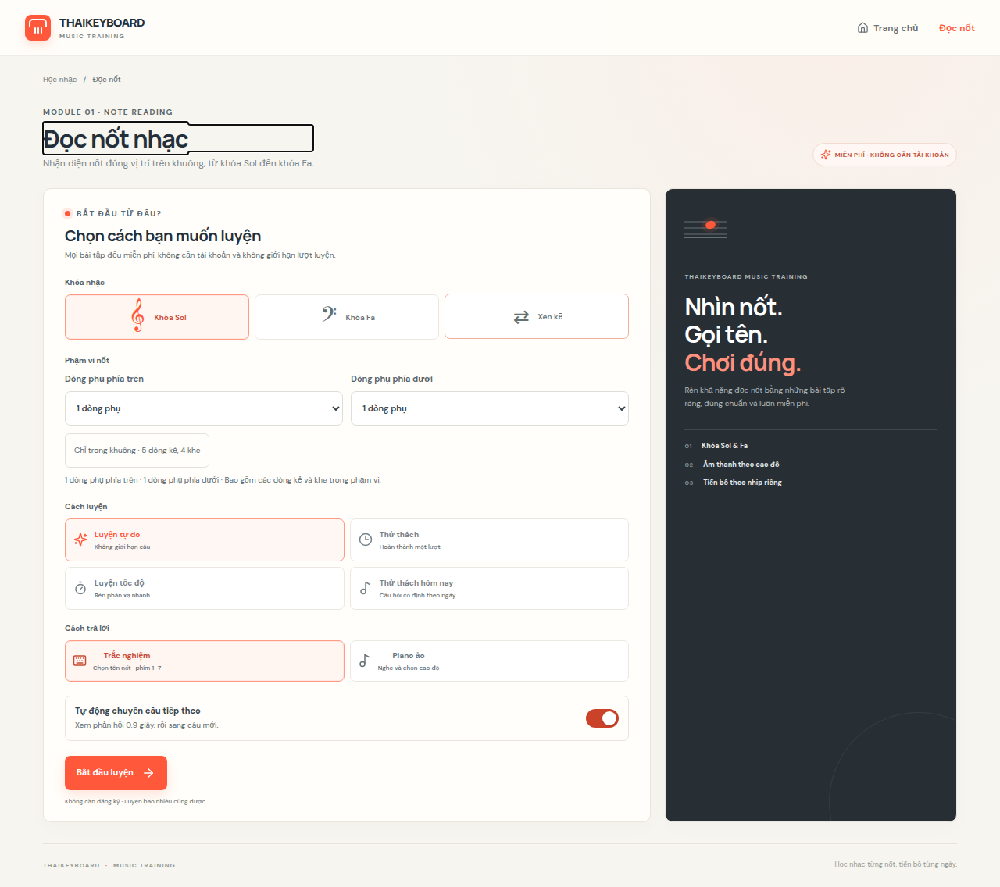
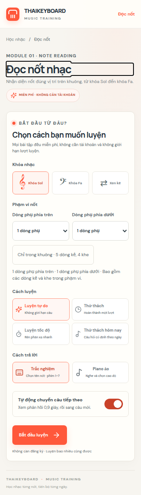
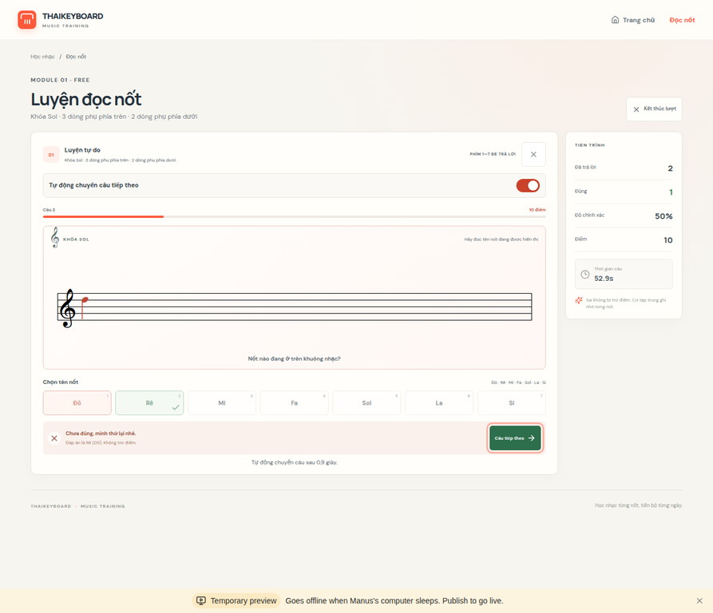
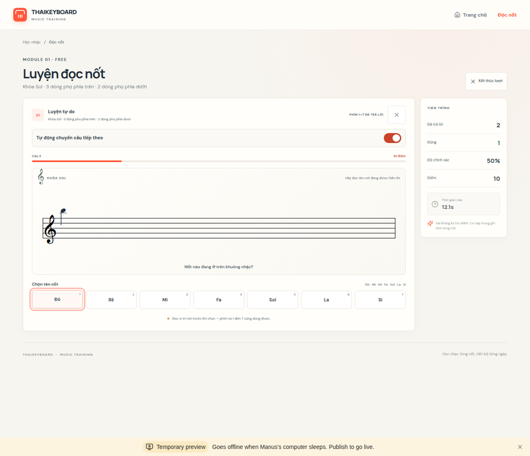

# Báo cáo cải tiến UX — Note Reading

**Ngày:** 10/11/2026. **Dự án:** THAIKEYBOARD Music Training. Chỉnh module hiện có, không rebuild kiến trúc, không thêm module, không đổi hạ tầng, không deploy/publish.

## 1. Tổng kết thay đổi

Đã thêm **auto-advance mặc định ON** cho trắc nghiệm và piano, với khoảng phản hồi **900ms**. Switch “Tự động chuyển câu tiếp theo” có ở setup và màn luyện. Preference được lưu cục bộ. Người học vẫn có thể chọn “Câu tiếp theo” ngay; khi OFF, phản hồi giữ nguyên đến thao tác tiếp tục.

Đã thay UI chỉ có ba preset range bằng hai select độc lập **“Dòng phụ phía trên” / “Dòng phụ phía dưới”**, từ0 đến4, mặc định1/1. Có nút **“Chỉ trong khuông · 5 dòng kẻ, 4 khe”** để chọn0/0. Cho phép bất đối xứng như2/1,3/2,4/0; lựa chọn được giữ qua phiên mới/reload. API range cũ vẫn tương thích cho consumer cũ, nhưng UI/generator hiện dùng trực tiếp các count mới.

## 2. Auto-advance và câu cuối

| Trạng thái | Hành vi đã triển khai và kiểm tra |
|---|---|
| ON, vừa trả lời | Chấm ngay, cộng10 hoặc0, khóa đáp án, hiện feedback và highlight đáp án đúng; sau900ms chuyển câu và reset controls |
| OFF, vừa trả lời | Chấm/feedback giống ON; không có timer chuyển câu; chờ “Câu tiếp theo” |
| Chuyển ngay | Nút “Câu tiếp theo” hủy timer đang chờ, chỉ chuyển một lần |
| OFF trong feedback | Hủy timer cũ, giữ phản hồi |
| Bật lại ON trong feedback | Bắt đầu một khoảng900ms mới; không dùng phần thời gian còn lại của timer trước |
| Reset/đổi session/thoát/kết thúc/unmount | Hủy timer; callback có sessionId/exerciseId để từ chối công việc stale đã vào hàng đợi |
| Chưa trả lời hoặc đang feedback | Không chấm/chuyển trùng; phím1–7 không gửi thêm đáp án trong feedback |
| Câu cuối Challenge/Daily, ON | Vẫn hiện nốt, đáp án và feedback cuối; sau900ms mới mở kết quả; có thể chọn “Xem kết quả” sớm |
| Câu cuối Challenge/Daily, OFF | Giữ feedback cuối; nút “Xem kết quả” mở màn kết quả |

Shared scoring reducer không thay đổi. Trang dùng thêm ref đồng bộ để khóa submission/transition trong cùng render, một hook timer nhỏ và trạng thái view kết quả riêng. Core session vẫn hoàn tất về mặt thống kê khi chấm câu cuối; view chỉ chuyển sau khi feedback được tiếp tục.

## 3. Phạm vi dòng phụ và độ chính xác

Dùng nguyên mô hình diatonic hiện hữu. Với `above` và `below` là hai số nguyên0..4:

```text
minPosition = -2 * below
maxPosition = 8 + 2 * above
validPositions = mọi số nguyên từ minPosition đến maxPosition, bao gồm hai đầu
```

| Cấu hình trên/dưới | Vị trí hợp lệ |
|---|---|
| 0/0 | 0..8 |
| 1/1 | -2..10 |
| 2/1 | -2..12 |
| 3/2 | -4..14 |
| 4/4 | -8..16 |

Bao gồm dòng kẻ, khe, dòng phụ, khe giữa các dòng phụ và khe sát bên ngoài khuông khi phía đó có mở rộng. Không thêm khe **vượt quá dòng phụ ngoài cùng đã chọn**. Staff-only0/0 chỉ lấy phần năm dòng kẻ và bốn khe trong khuông.

Cùng `NoteEvent` tiếp tục điều khiển VexFlow, letter, octave, MIDI, đáp án và piano. Mốc khóa Sol vẫn E4, khóa Fa vẫn G2; công thức pitch không đổi. Toàn khoảng hỗ trợ hiện tại giữ octave1..6: cực hạn khóa Sol D3..G6, khóa Fa F1..B4.

Đã kiểm tra đủ **25 tổ hợp count**, cả Sol/Fa/Mixed, các endpoint và mọi vị trí nội bộ bằng RNG xác định. Daily seed có cả count trên/dưới; cấu hình bất đối xứng khác nhau sinh chuỗi riêng. Khi không truyền custom ledgerRange, các seed/range API cũ giữ hành vi cũ.

Renderer `VexFlowStaff.tsx` **không bị thay đổi trong đợt UX này**. Kiểm tra browser thực tế gồm50 vị trí × hai chiều rộng SVG420/256px = **100 lần render**. Notehead origin khớp `y=134−6p`; có một notehead, năm dòng kẻ; bounding rectangle engraving do VexFlow tạo nằm trong SVG198px. Ở p=-8, rectangle kết thúc tại187px; p=16 bắt đầu tại33px. Không dùng CSS để ước lượng vị trí hay pixel ảnh để tìm đáp án.

## 4. Ảnh giao diện và auto-advance

Các ảnh là ảnh ứng dụng thật. Setup được chụp bằng công cụ screenshot dự án; cặp auto-advance được chụp khi click thật trong browser, không đóng băng timer hoặc dựng lại UI.

### Setup desktop, mặc định1/1 và ON



### Setup mobile320px



### Feedback Câu2 trước khi tự chuyển

Sai +0, điểm trước đó được giữ; Rê là đáp án đúng được highlight, switch vẫn ON và có nút chuyển ngay.



### Câu3 sau khi tự chuyển

Controls đã reset, feedback cũ biến mất, score giữ10 và tổng đã trả lời giữ2. Không có thêm click đáp án giữa hai ảnh.



## 5. Test trước và sau

| Kiểm tra | Trước | Sau cuối |
|---|---:|---:|
| Vitest | 98/98,13 tệp | **141/141,17 tệp** |
| TypeScript `pnpm check` | Baseline hiện hữu sạch | **Đạt, exit0** |
| `pnpm build:static` | Baseline QA đã đạt | **Đạt, exit0** |
| `pnpm build` | Baseline QA đã đạt | **Đạt, exit0** |
| `git diff --check` | Sạch | Sạch |

Giữ toàn bộ98 test/invariant cũ. Chỉ cập nhật selector preset cũ thành hai select, chạy các test manual cũ với preference OFF, và thêm thao tác “Xem kết quả” sau feedback cuối đúng UX mới. Không xóa test chấm điểm/nhạc lý/piano để làm suite xanh.

Các test mới/được mở rộng bao phủ:

- ON/OFF và đúng/sai cho cả trắc nghiệm/piano;900ms và không tự chuyển câu chưa trả lời.
- Touch pointer mô phỏng cho hai phương thức; keyboard chặn duplicate trong feedback.
- Manual-next khi timer chờ, chấm lặp/click chuyển lặp trong cùng render; reset, end, unmount.
- OFF/ON giữa feedback; khoảng chờ mới khi bật lại.
- Câu cuối Challenge và Daily ở cả hai phương thức, ON và OFF.
- Preference defaults/persistence/malformed JSON/storage bị chặn.
- Staff-only, count1/2/3/4 đối xứng và bất đối xứng, Sol/Fa/Mixed, bounds/answer/MIDI/octave/seed.
- UI custom4/0 đi qua trang vào SVG/chấm đáp án; renderer test mở rộng đủ25 vị trí mỗi khóa.
- Public module adapter chuyển đúng ledgerRange và từ chối count không hợp lệ, đồng thời giữ legacy input.

**Lỗi được tìm và sửa:** rà soát độc lập phát hiện adapter `noteReadingModule.generateExercise` ban đầu chưa forward ledgerRange mới. Hồi quy trước sửa bắt hai lỗi: sinh vị trí8 thay vì16 khi chọn4/0 và bỏ qua validation count5. Đã thêm field forward; cả ba adapter test đạt, toàn suite141 đạt.

**Lỗi harness, không phải lỗi ứng dụng:**16 test timer mới ban đầu timeout do React Testing Library wrapper chờ setTimeout0 dưới Vitest fake timers. Đã sửa wrapper trong riêng tệp UX, dùng act cho timer/direct-event. Một assertion browser ban đầu dùng SVG `text.getBBox` đã lấy cả font metrics, không phải ink notehead; đã phân loại sai số harness và kiểm tra lại bằng origin/engraving bounds đúng của VexFlow. Không sửa renderer để “sửa” metric này. Các lỗi lịch sử vẫn có trong bằng chứng; không tuyên bố mọi assertion đạt ngay từ lần đầu.

## 6. Kiểm tra browser và responsive

Luồng browser đã thử: setup custom3/2; auto ON, OFF, bật/tắt giữa feedback; manual chuyển khi timer chờ; reset; piano đúng/sai; Daily cuối ON; Challenge cuối OFF; kết quả và quay lại; preference4/4+ON giữ sau reload.

Timer cấu hình900ms; thời điểm chuyển quan sát bằng harness real clock khoảng **943.1ms** và **959.5ms**, bao gồm scheduling/quan sát DOM. Không tăng delay ứng dụng để chụp ảnh.

| Viewport | SVG/host | Custom range | Kết quả |
|---:|---|---|---|
| 320px | 256/256px | 4/4, Fa, piano | Feedback và tự chuyển đạt; không page overflow |
| 390px | 311/311px | 4/4, Fa, piano | Đạt |
| 768px | 431/431px | 4/4, Fa, piano | Đạt |
| 1280px | 875/875px | 4/4, Fa, piano | Đạt |

Viewport dùng iframe cùng origin trong Chromium để đo layout thật, không phải thiết bị vật lý. Bàn phím piano giữ cuộn ngang nội bộ có chủ ý. Không ghi nhận lỗi JavaScript ứng dụng trong các flow browser đã thử. Bằng chứng chính lưu162 assertion lịch sử (một lỗi font-metric harness đã được phân loại),100 fixture và25 range; kiểm tra persistence sau reload lưu riêng.

## 7. Bảo toàn và build

Không đổi stack, route, dependency/lockfile, VexFlow renderer, core session/scoring, server/shared/database/migration, Dockerfile hay cấu hình platform. `manus-routes.json` vẫn đúng `/` và `/note-reading`. Mô hình letter/octave/MIDI/VexFlowKey giữ nguyên về mặt tính toán; chỉ thêm helper range và optional config fields. README và phần bổ sung plan được cập nhật, không thay kiến trúc cũ.

Build còn cảnh báo chunk notation lớn: khoảng **1,221.35kB raw /715.35kB gzip**, vẫn lazy-load theo route. Script runtime config classic có cảnh báo bundling như trước; output được sinh thành công. Đây không phải build failure và không bị che bằng tắt cảnh báo.

## 8. GitHub và không triển khai

Repository giữ nguyên: **`thaikeyboard178-art/thaikeyboard-music-platform`**, private, canonical `main`.

Base khi bắt đầu: `bf5db92a5d855423681443a71f01da023c1d8fb6`.

Source UX/tests/ảnh đã commit và push thành công:

**`05bc1303345b19d7e3bbbb8d0d674baa4e87038b`** — `Add note reading auto advance and custom ledger ranges`.

GitHub xác nhận `bf5db92..05bc130 main -> main`. Report/TODO được lưu tiếp bằng commit chỉ tài liệu; SHA cuối/worktree sạch được ghi trong bản bàn giao cuối. Không force-push, đổi remote, rewrite history, deploy, publish hay sửa WordPress. `publishing.auto_publish` được kiểm tra là **false** trước push.

## 9. Giới hạn còn lại

Các preference được giữ trong cùng browser/origin, không cloud-sync; active session vẫn chỉ trong bộ nhớ. Chỉ auto switch thay đổi giữa session; ledger count thay đổi ở setup để tránh range/seed đổi giữa một lượt.

Touch đã được mô phỏng bằng pointer test, chưa thử ngón tay trên thiết bị thật. Chưa chứng nhận Safari/iOS, Android/WebView, screen reader, zoom400%, loa/tai nghe, tab background/throttling, mạng yếu hay full WCAG. Khoảng900ms có thể bị browser trì hoãn khi tab ngủ; không có known timer race trong kiểm tra hiện tại nhưng click đúng biên scheduling trên các browser vẫn cần thử thật.

Nốt generator vẫn là nốt tự nhiên; không thêm bài tập thăng/giáng/hóa biểu, rhythm hay chord. Chưa chạy OAuth/database/migration/production Docker vì không thuộc hai thay đổi UX và không được phép deploy.

## 10. Tái chạy và bằng chứng

```bash
pnpm install --frozen-lockfile
pnpm check
pnpm test
pnpm build:static
pnpm build
pnpm dev:static
```

Log trước/sau, type/build và JSON browser nằm cùng thư mục QA trong sandbox; log bị Git ignore theo quy tắc hiện có. Source/tests, ảnh, JSON browser/persistence và báo cáo được lưu trên GitHub. Không có giá trị secret mới được tạo hoặc export.
